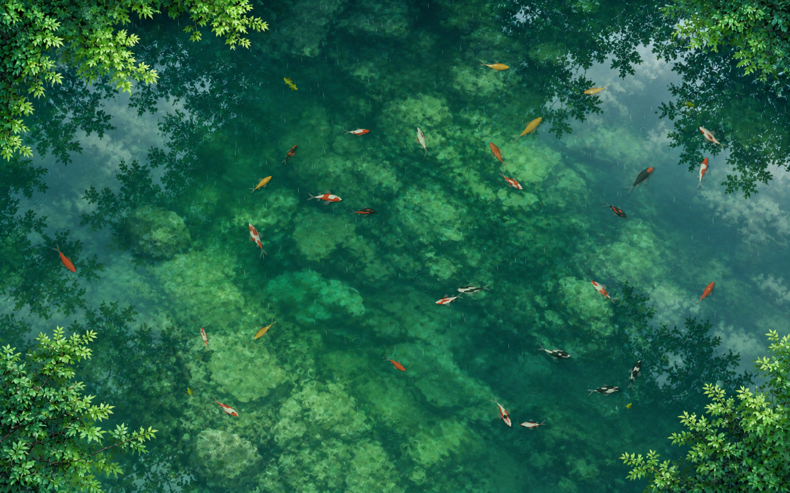
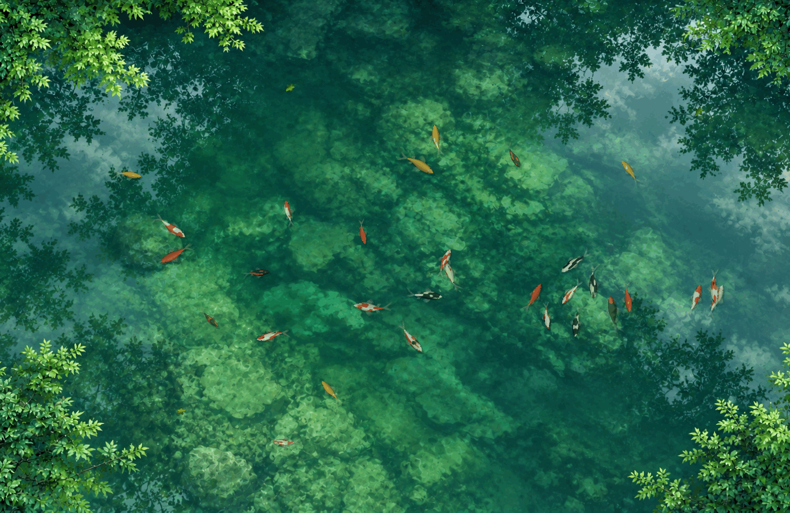
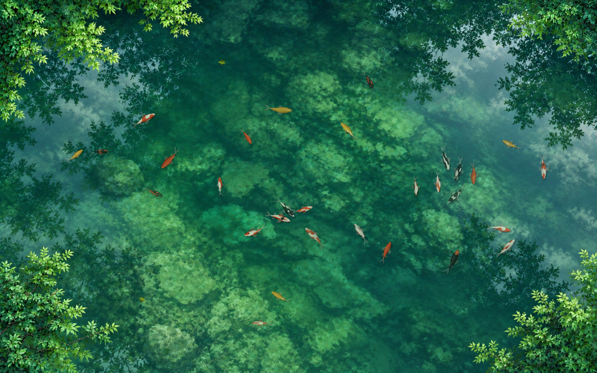
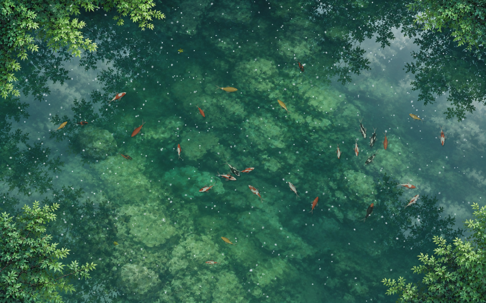
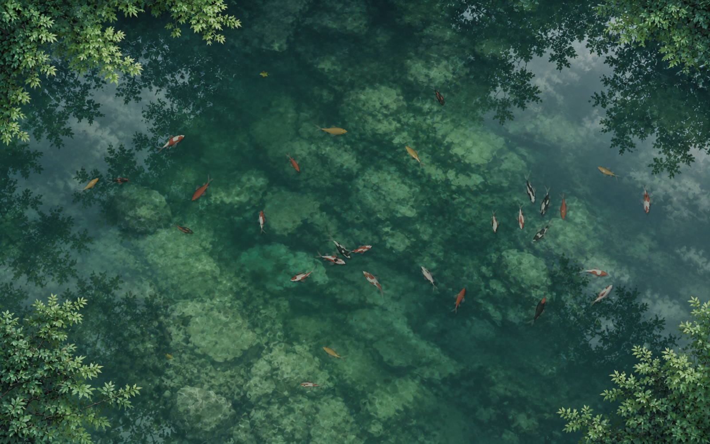
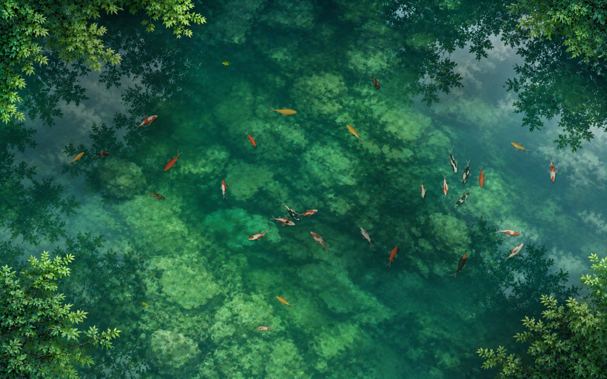
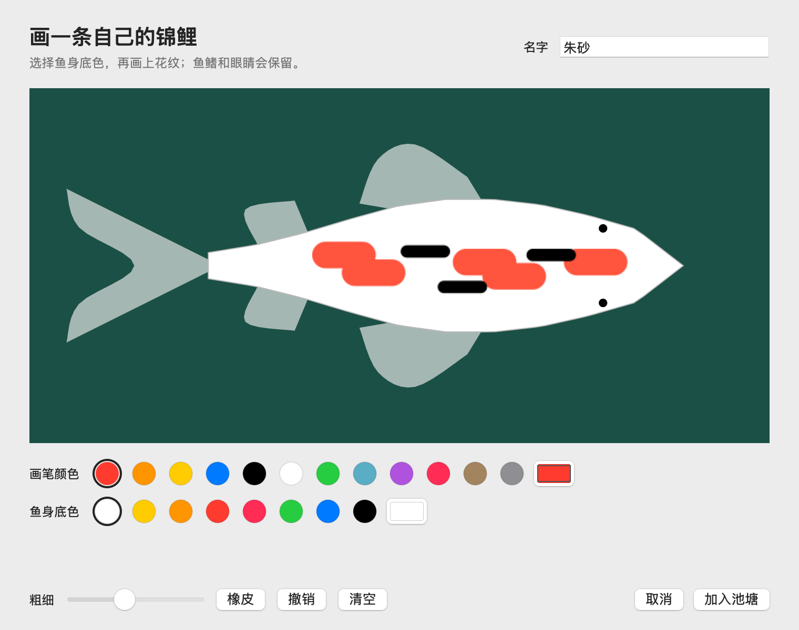
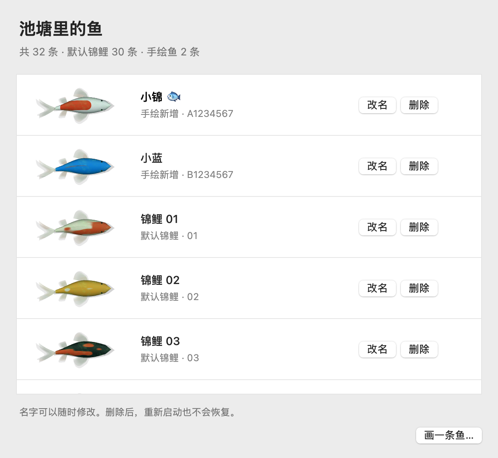

<div align="center">

# Pond · MacAquariumWallpaper

**A little living pond on your Mac desktop.**

Koi swim through green water. Rain and snow touch the surface. Move your pointer to leave a wake—or draw a fish of your own.

macOS 14+ · Swift / AppKit / Metal · Local execution · Menu bar app

[简体中文](README.md) · [Get started](#get-started) · [Development guide](docs/development.md)

</div>



The visuals on this page come from the current renderer and native views with demonstration data. They are not concept art or captures of a personal desktop. [Image provenance](docs/images/README.md).

## Features

- **Living koi:** 30 fish by default, with animated tails, natural turns, and local avoidance.
- **Interactive water:** move across exposed desktop water to create a spreading wake; click for a stronger ripple and a brief scattering of nearby fish.
- **Five weather modes:** sunny, rainy, snowy, overcast, and cloudy. Falling rain, melting snow, drifting shadows, and smooth transitions.
- **Draw your own fish:** choose a base color, paint patterns, add a name, and release it into the pond. Includes color presets, custom colors, brush size, eraser, undo, and clear.
- **Manage the pond:** preview, rename, or delete built-in and custom fish. Changes persist locally across launches.
- **Native desktop integration:** the scene sits below icons and regular windows without taking focus or consuming clicks. Hide it, pause it, or disable interaction from the menu bar.



This GIF uses a scripted pointer path and is exported at 15 FPS. The app targets 30 FPS.

| Sunny | Snowy |
| --- | --- |
|  |  |
| **Overcast** | **Cloudy** |
|  |  |

| Draw a fish | Manage your fish |
| --- | --- |
|  |  |

## Get started

Version **0.1.0** is currently distributed as source. Local builds use ad-hoc signing; no notarized installer is provided.

Requirements: macOS 14+, a Metal-capable Mac, and Xcode Command Line Tools or Xcode with a compatible Swift compiler and macOS SDK. Validated on Apple Silicon running macOS 15.7.4. Intel hardware is unverified, and some test scripts target arm64 explicitly. No third-party packages or runtime account are required.

Install development tools if needed:

```bash
xcode-select --install
```

Then clone and build:

```bash
git clone https://github.com/Harvey-Wen/MacAquariumWallpaper.git
cd MacAquariumWallpaper
bash scripts/build.sh
open build/MacAquariumWallpaper.app
```

Click the **fish icon in the menu bar**. The app starts with rainy weather and has no persistent Dock icon or main window. You can copy the built `.app` into Applications.

The interface is currently in Chinese:

| Menu item | Action |
| --- | --- |
| 画一条鱼… | Draw and add a fish |
| 鱼的列表… | Preview, rename, or delete fish |
| 显示池塘 | Show or hide the pond |
| 暂停游动 / 继续游动 | Pause or resume the scene |
| 鼠标互动 | Toggle pointer interaction |
| 天气 | Select weather |
| 退出池塘 | Quit and attempt to restore the original background |

## Desktop behavior and privacy

The app draws with AppKit and Metal. To blend the system menu bar into the pond, it temporarily sets the primary display's wallpaper to a still rendered frame. Hiding or quitting restores the saved background. If you change the wallpaper yourself while the app runs, that choice is preserved.

It does not request Accessibility or Screen Recording permission at launch. It observes mouse events and public window bounds, without global keyboard monitoring, screen-pixel capture, or data uploads. Custom fish and names are stored locally:

```text
~/Library/Application Support/local.macaquariumwallpaper.app/CustomFish/
```

Wallpaper recovery records live in the neighboring `DesktopBackdrop/` directory. See the [Chinese usage guide](docs/usage.md) for backup and recovery details.

## Current limitations

- Primary display only; the environment image is center-cropped for different aspect ratios.
- Targets 30 FPS. Sleep and screen lock stop rendering; Reduce Motion produces a static scene.
- The menu bar background is a still frame and is not regenerated for each weather change. macOS controls its tint and transparency.
- Full restoration of dynamic wallpapers, rotation settings, and per-Space state is not guaranteed. Some multi-display and Spaces behaviors still require manual verification.
- No audio, built-in launch-at-login setting, or notarized prebuilt package.

## Development and assets

[Development and tests](docs/development.md) · [Contributing](CONTRIBUTING.md) · [Performance measurements](docs/optimization-acceptance-2026-09-28.md)

The environment texture was generated with an AI image tool. Fish, waves, precipitation, cloud shadows, and floating leaves are rendered in real time. [Asset history](docs/concepts/README.md) and [preview provenance](docs/images/README.md) distinguish concept images from renderer output. Supporting guides are currently in Chinese.

**License:** no open-source license has been designated for this repository yet.
