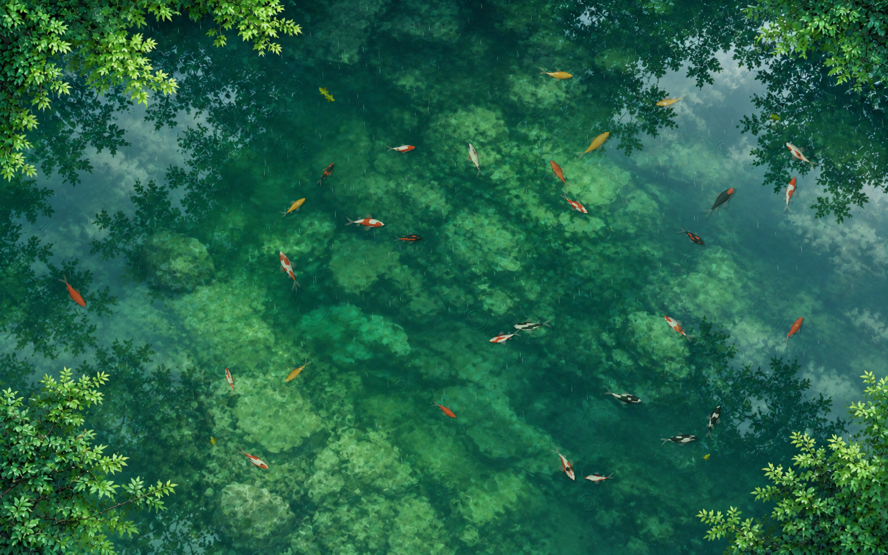
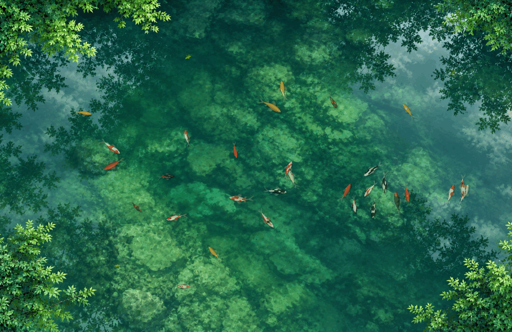
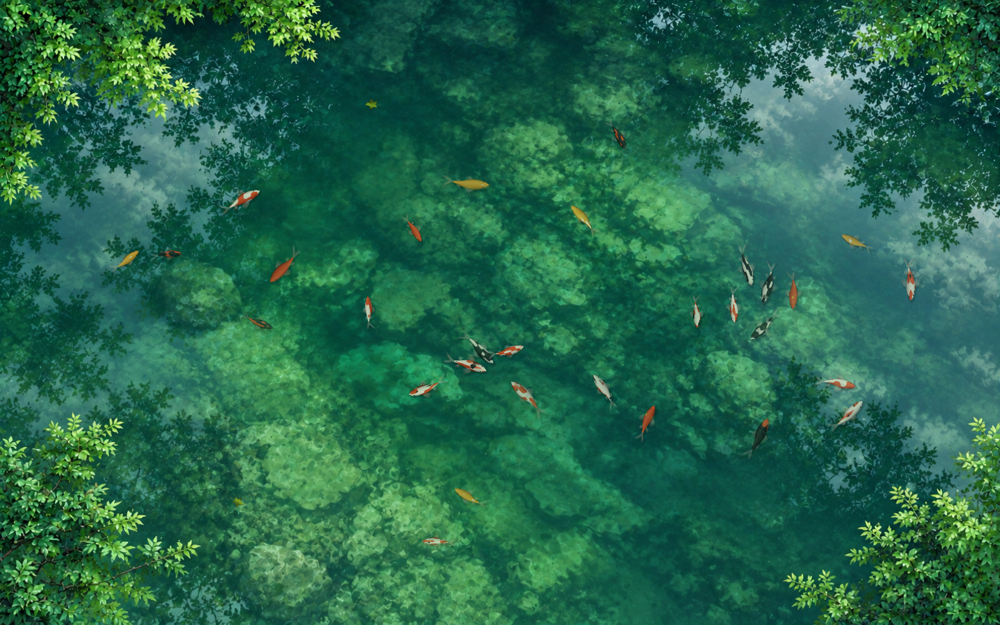
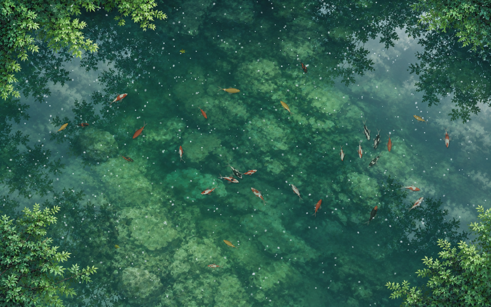
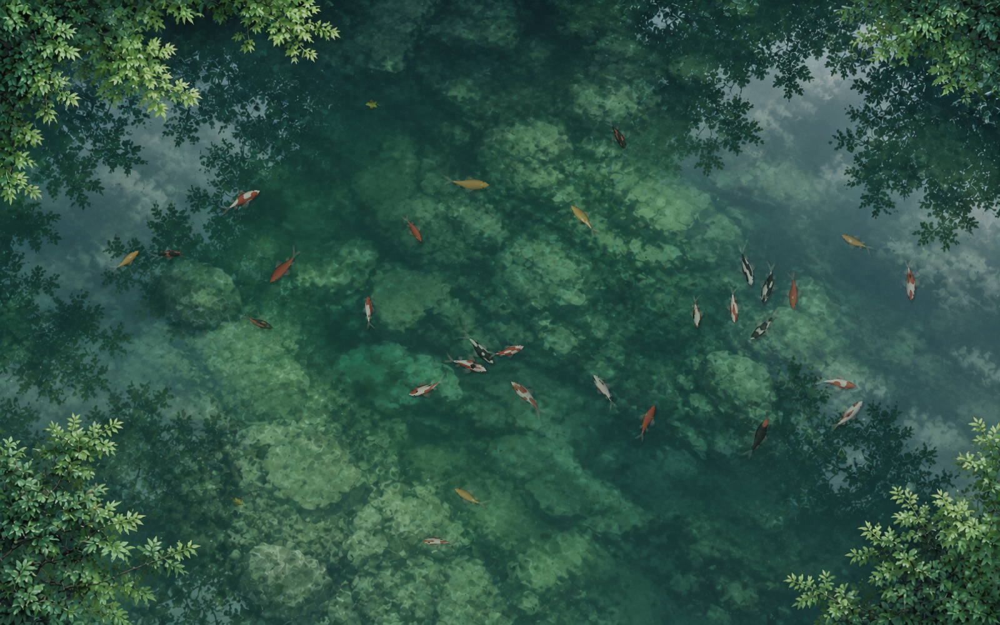
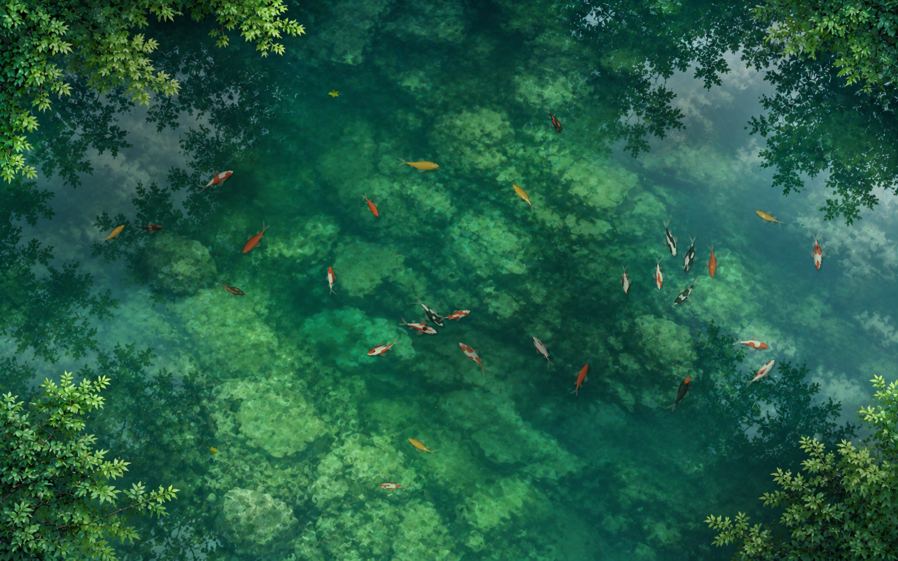
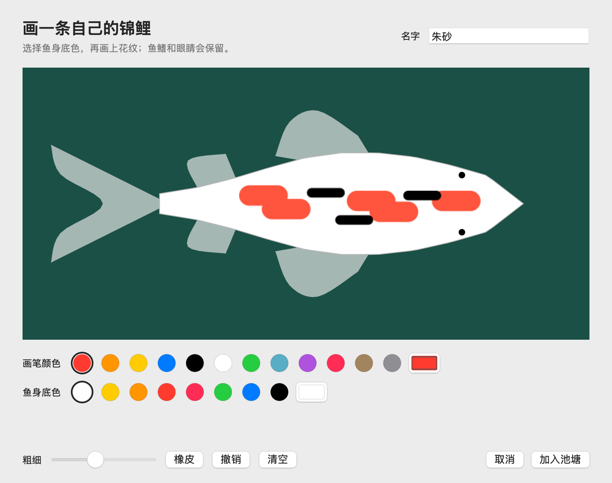
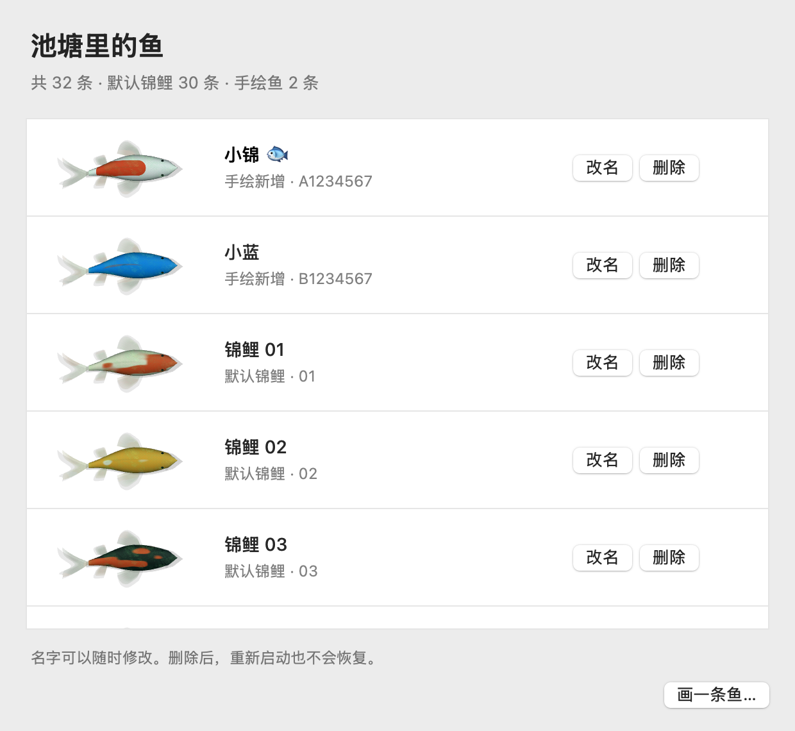

<div align="center">

# 池塘 · MacAquariumWallpaper

**把桌面变成一池会呼吸的绿水。**

锦鲤游动，雨雪落水，鼠标拂过泛起涟漪。也可以画一条自己的鱼，放进池塘。

macOS 14+ · Swift / AppKit / Metal · 本地运行 · 菜单栏应用

[English](README.en.md) · [快速开始](#快速开始) · [使用指南](docs/usage.md) · [开发与验证](docs/development.md)

</div>



> 图片来自当前版本的实际 Metal 渲染；界面图使用独立演示数据。它们不是概念图，也不是个人桌面截图。[查看素材说明](docs/images/README.md)

## 在桌面养一池鱼

- **自然游动** — 默认 30 条锦鲤，带摆尾、转向和局部避让；水面延伸到画面之外，四角有枝叶探入。
- **鼠标互动** — 滑过桌面水域留下向后展开的波纹，附近的鱼会短暂避开；点击水面激起更明显的涟漪。
- **五种天气** — 晴天、雨天、下雪、阴天和多云。雨丝落水，雪片漂浮后融化，云影缓慢移动，天气切换平滑衔接。
- **画自己的鱼** — 选择底色、画花纹、取名字，再加入池塘。支持预设色、自选颜色、粗细、橡皮、撤销与清空。
- **管理每条鱼** — 查看真实外观缩略图，给默认锦鲤或手绘鱼改名、删除；更改保存在本地，重启后保留。
- **融入桌面** — 位于桌面图标和普通窗口下方，不抢焦点，鼠标继续操作图标和应用；菜单里可隐藏、暂停或关闭互动。

### 鼠标拂过，水波散开



动态预览由真实渲染器以脚本化鼠标路径生成，导出为 15 FPS GIF；应用的目标帧率为 30 FPS。

### 一池水，五种天气

雨天见首页大图，其余四种天气如下：

| 晴天 · Sunny | 下雪 · Snowy |
| --- | --- |
|  |  |
| **阴天 · Overcast** | **多云 · Cloudy** |
|  |  |

### 把自己画的鱼放进去

| 画花纹、选底色、取名字 | 查看、改名与管理 |
| --- | --- |
|  |  |

## 快速开始

当前提供源码构建，应用版本为 **0.1.0**，使用本地 ad-hoc 签名，尚未提供公证安装包。

### 环境

- macOS 14 或更高版本，以及支持 Metal 的 Mac。
- 安装 Xcode Command Line Tools 或 Xcode，提供 Swift 编译器与 macOS SDK。
- 已在 Apple Silicon / macOS 15.7.4 上验证；Intel Mac 尚未实机验证，部分测试脚本固定使用 arm64。
- 无第三方包依赖，运行时无需联网或账号。

首次安装开发工具（已安装可跳过）：

```bash
xcode-select --install
```

克隆、构建并打开：

```bash
git clone https://github.com/Harvey-Wen/MacAquariumWallpaper.git
cd MacAquariumWallpaper
bash scripts/build.sh
open build/MacAquariumWallpaper.app
```

启动后在菜单栏点击**鱼形图标**。应用默认展示雨天池塘；没有常驻 Dock 图标或普通主窗口。需要时可将构建出的 `.app` 复制到“应用程序”文件夹。

| 菜单 | 用途 |
| --- | --- |
| 画一条鱼… | 打开绘画窗口，点击“加入池塘”保存并新增 |
| 鱼的列表… | 查看外观、改名或删除任意一条鱼 |
| 显示池塘 | 显示或隐藏桌面场景 |
| 暂停游动 / 继续游动 | 暂停或恢复整个场景的动态效果 |
| 鼠标互动 | 开关水波与鱼群的鼠标响应 |
| 天气 | 切换晴天、雨天、下雪、阴天或多云 |
| 退出池塘 | 退出应用并尝试恢复原系统背景 |

## 桌面、权限与本地数据

应用通过 AppKit 桌面窗口与 Metal 绘制场景。为了让系统菜单栏融入池塘，会暂时把主屏系统背景设为池塘的静态渲染帧；隐藏或正常退出时恢复保存的原背景。期间若你自行换了背景，应用会保留你的选择。

启动不请求辅助功能或屏幕录制权限。应用观察鼠标事件和公开窗口矩形，不监听全局键盘、不采集屏幕像素、不上传数据。手绘鱼和鱼名存放在：

```text
~/Library/Application Support/local.macaquariumwallpaper.app/CustomFish/
```

背景恢复记录位于同级的 `DesktopBackdrop/`。详细恢复行为、备份方法和故障排查见[使用指南](docs/usage.md)。

## 当前边界

- 仅渲染**主屏**；不同屏幕比例会居中裁切环境图。
- 目标 30 FPS，实际表现取决于设备、分辨率与场景。休眠、锁屏会停止绘制，系统开启“减少动态效果”时静止显示。
- 菜单栏底图是静态帧，不随每次天气切换更新；透明度和色调由 macOS 决定。
- 动态壁纸、轮播、多显示器和不同 Space 的完整系统背景状态仍有恢复与验收限制。
- 当前应用界面为中文。没有声音、开机自启动设置或预编译的公证安装包。

## 进一步了解

| 文档 | 内容 |
| --- | --- |
| [使用指南](docs/usage.md) | 操作细节、保存规则、桌面行为与常见问题 |
| [开发与验证](docs/development.md) | 代码结构、构建、测试、诊断与预览生成 |
| [参与贡献](CONTRIBUTING.md) | 问题反馈与改动验证约定 |
| [效果图说明](docs/images/README.md) | 实际渲染图、界面图与生成方法 |
| [环境素材来源](docs/concepts/README.md) | AI 生成底图与视觉演进记录 |
| [性能与优化验收](docs/optimization-acceptance-2026-09-28.md) | 测量条件、结果及未覆盖范围 |

池塘环境底图由 AI 工具生成；鱼、水波、降水、云影与漂浮落叶由程序实时绘制。历史概念图单独保存在 `docs/concepts/`。

**许可证**：仓库目前尚未指定开源许可证。
